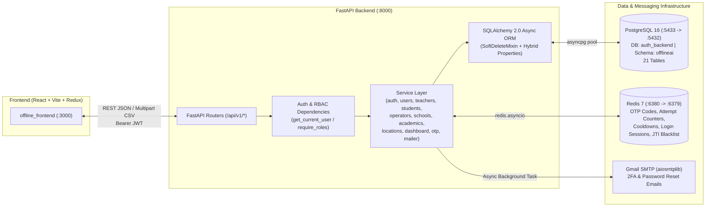

# Offline AI Platform — Complete End-to-End Engineering Documentation

> **Note:** This document is the complete, authoritative record of everything architected, built, hardened, audited, and containerized across **`offline_ai_backend`** (`D:\Work\TechnoExponent\offline_ai_backend`) and **`offline_frontend`** (`D:\Work\TechnoExponent\offline_frontend`), while preserving **`offline_ai`** (`D:\Work\TechnoExponent\offline_ai`) as an untouched read-only reference codebase.

---

## 1. System Architecture Overview



### Directory Structure (`offline_ai_backend`)
- **`app/main.py`** — FastAPI application entrypoint, CORS middleware, lifespan hooks (`ensure_db_schema()`, Redis ping, graceful shutdown), and router registration.
- **`app/core/`**
  - `config.py` — Pydantic `BaseSettings` reading `.env` (PostgreSQL, Redis, JWT, OTP, Gmail SMTP settings).
  - `database.py` — SQLAlchemy `create_async_engine`, `AsyncSessionLocal`, `get_async_db` dependency, and `ensure_db_schema()` auto-initializer.
  - `redis.py` — Singleton async Redis client (`decode_responses=True`).
  - `security.py` — Bcrypt password hashing/verification (12 rounds, 72-byte enforcement, constant-time `DUMMY_PASSWORD_HASH`) and PyJWT token creation/decoding (`ACCESS`, `PASSWORD_RESET`, `GUARDIAN_SELECT`).
  - `response.py` — Unified response envelope (`success_response`, `paginated_data`, `error_response`), `AppError` exception class, validation error formatter, and SQLAlchemy `IntegrityError` handler.
- **`app/models/`** — SQLAlchemy 2.0 declarative models across 21 tables in the `offlineai` schema (`base.py`, `user.py`, `location.py`, `academic.py`, `school.py`, `assignments.py`).
- **`app/schemas/`** — Pydantic v2 request/validation schemas (`auth.py`, `academics.py`, `school.py`, `users.py`).
- **`app/services/`** — Business logic layer (`auth_service.py`, `otp_service.py`, `mailer_service.py`, `user_service.py`, `admin_user_service.py`, `teacher_service.py`, `classroom_operator_service.py`, `student_service.py`, `school_service.py`, `academic_service.py`, `location_service.py`, `dashboard_service.py`).
- **`app/api/v1/`** — FastAPI HTTP routers (`auth.py`, `locations.py`, `academics.py`, `schools.py`, `users.py`, `dashboard.py`).
- **`sql/init.sql`** — Idempotent PostgreSQL schema creation, triggers, indexes, and seed data.

---

## 2. Phase 1: Initial Authentication Build (Initial Specification & Foundation)

The initial foundation (documented in `AUTH_BUILD_SPEC.md`) established a clean, standalone authentication backend designed to match the React frontend (`offline_frontend`) without carrying over legacy bugs:

1. **Two-Step 2FA Login Flow**:
   - **Step 1 (`POST /api/v1/auth/login`)**: Validates `identifier` (email) + `password` against `offlineai.users`. Always runs `bcrypt.checkpw` against `DUMMY_PASSWORD_HASH` when an email does not exist to prevent timing-based account enumeration. Issues a 6-digit OTP in Redis (`otp:login:<email>`) with a 300s TTL and emails it via Gmail SMTP (`aiosmtplib`), returning `{"verification_required": true}`.
   - **Step 2 (`POST /api/v1/auth/verify`)**: Verifies the 6-digit OTP in constant time (`secrets.compare_digest`), enforces max 5 attempts (`otp_attempts:login:<email>`), updates `last_login_at`, and issues a 24-hour HS256 access JWT (`purpose: "access"`).
2. **Three-Step Forgot / Reset Password Flow**:
   - **Step 1 (`POST /api/v1/auth/forgot-password`)**: Issues a purpose-scoped OTP (`otp:forgot_password:<email>`) and sends it via email. Always returns HTTP 200 regardless of whether the email exists to prevent user enumeration.
   - **Step 2 (`POST /api/v1/auth/forgot-password/verify`)**: Validates the OTP and issues a short-lived (15-minute), single-purpose JWT (`purpose: "password_reset"`) with a unique `jti` claim.
   - **Step 3 (`POST /api/v1/auth/reset-password`)**: Verifies the `reset_token`, checks Redis (`used_reset_token:<jti>`) to ensure single use, enforces password reuse protection and complexity rules, hashes the new password with bcrypt, updates PostgreSQL, and records the `jti` in Redis for 15 minutes.
3. **Standard Response Envelope**:
   - Every response follows the exact shape expected by the React Redux actions and Axios interceptors:
     ```json
     {
       "success": true,
       "message": "...",
       "data": { ... },
       "verification_required": false,
       "errors": null
     }
     ```

### 2.1 Five-Domain Security & Compliance Matrix
| Security Domain | Threat / Requirement | Code-Level Enforcement |
| :--- | :--- | :--- |
| **1. Authentication Security** | Plain-text password checking & OTP exposure in API responses | Native `bcrypt` (`BCRYPT_ROUNDS = 12`) + `DUMMY_PASSWORD_HASH` anti-timing verification in `app/core/security.py`. **Zero OTPs are ever returned in HTTP JSON responses** (`/login`, `/resend-otp`, `/forgot-password`, `/student/request-otp` return only `verification_required: true` or status messages; OTPs are sent out-of-band via `mailer_service.py`). |
| **2. OTP Security Controls** | Expiry, rate limiting, and single-use validation | `OTP_EXPIRE_SECONDS = 300` (5-min Redis TTL), `OTP_RESEND_COOLDOWN_SECONDS = 30` (`otp_cooldown:{purpose}:{id}`), `OTP_MAX_ATTEMPTS = 5` brute-force counter (`otp_attempts:{purpose}:{id}`), and immediate deletion of Redis OTP + session keys upon verification in `app/services/otp_service.py`. |
| **3. Password Reset & Complexity** | Password reuse protection & strong password enforcement | `reset_password()` and `change_password()` in `app/services/auth_service.py` reject reusing the current password (`verify_password(new_password, user.hashed_password)` -> `400 Bad Request`). `_validate_strong_password()` in `app/schemas/auth.py` and `PasswordCheckMixin` in `app/schemas/users.py` enforce 8–72 UTF-8 bytes, $\ge 1$ uppercase, $\ge 1$ lowercase, $\ge 1$ digit, and $\ge 1$ special character. Single-use reset tokens are tracked via `used_reset_token:{jti}` in Redis. |
| **4. Access Control (RBAC)** | User, school, location & academic management authorization | `get_current_user` verifies active non-deleted DB status on every request. `get_current_admin_user_id` guards all User Management & Bulk Upload routes (`users.py`), School mutations & exports (`schools.py`), Location mutations (`locations.py`), Academic mutations (`academics.py`), and Dashboard/Permissions routes (`dashboard.py`). |
| **5. Data Protection (CSV & Stats)** | CSV export & statistics API access control and input validation | `GET /api/v1/school/export` and `GET /api/v1/dashboard/summary` require `Depends(get_current_admin_user_id)`. Query inputs (`search` `max_length=100`, `status` regex pattern, UUID filters) are strictly validated, and `_sanitize_csv_cell()` in `app/services/school_service.py` neutralizes CSV Formula Injection (`=`, `+`, `-`, `@`, `\t`, `\r`). |

---

## 3. Phase 1.5: Critical Security & Reliability Hardening

Immediately following the initial build, we audited and fixed four security, crash, and UX issues:

### 3.1 [CRITICAL / SECURITY] Password Bypass (2FA → 1FA) on `POST /api/v1/auth/resend-otp`
- **Vulnerability**: `resend_login_otp()` previously accepted `{"email": "..."}` with no proof that `login()` had verified the user's password first, minting a valid `OtpPurpose.LOGIN` code in Redis. An attacker could skip `/login`, call `/resend-otp`, and complete login at `/verify` without knowing the password. It also leaked account existence via `429` responses and skipped `is_active(user)`.
- **Fix** (`app/services/otp_service.py`, `app/services/auth_service.py`):
  - Introduced a Redis login-session marker (`otp_login_session:<email>`) via `start_login_session()` that is **only** set after `login()` verifies the user's password.
  - `resend_login_otp()` checks `has_login_session(email)` and `user_service.is_active(user)`. If no password-authenticated session exists, it silently returns (`200 OK` no-op) so unauthenticated callers can neither mint a login OTP nor enumerate accounts.
  - `verify_otp()` also requires `has_login_session(email)` for `OtpPurpose.LOGIN` and cleans up the session key upon consumption or max-attempt lockout.

### 3.2 [HIGH / CRASH] `500 Internal Server Error` on Passwords > 72 Bytes (Bcrypt Limit)
- **Vulnerability**: Modern `bcrypt` (`>=4.1.2`) raises `ValueError: password cannot be longer than 72 bytes` instead of truncating. Submitting a >72-byte password crashed `/login` and `/reset-password` with an unhandled `500`.
- **Fix** (`app/core/security.py`, `app/schemas/auth.py`, `app/schemas/users.py`):
  - Added UTF-8 byte-length validators (`len(password.encode("utf-8")) <= 72`) across `LoginRequest`, `ResetPasswordRequest`, `ChangePasswordRequest`, and `PasswordCheckMixin` (inherited by all 12 user create/update schemas), returning `422 Unprocessable Entity`.
  - Hardened `verify_password()` to return `False` immediately if `len(password_bytes) > 72` or on `ValueError`.

### 3.3 [MEDIUM / RELIABILITY & TIMING] SMTP Failure Cooldown Lock & Timing Side-Channel
- **Vulnerability**: `issue_otp()` set the 30-second cooldown key in Redis before `send_email()` ran. If SMTP failed, the user got a `500` error and was locked out for 30 seconds (`429`) with no email sent. Additionally, awaiting SMTP synchronously on `/forgot-password` created a ~2s timing side-channel for valid emails.
- **Fix** (`app/services/otp_service.py`, `app/services/auth_service.py`):
  - Added `revoke_otp(purpose, email)` to delete the OTP, attempt counter, and cooldown keys if SMTP delivery fails, returning a clean `503 Service Unavailable` so the user can retry immediately.
  - Moved `/forgot-password` email dispatch into `_send_otp_email_in_background()` via `asyncio.create_task`, eliminating the timing side-channel while still revoking the Redis OTP on background SMTP failure.

### 3.4 [UX FIX] Redirect to Login Page After Password Reset
- **Issue**: After completing password reset on `ForgotPasswordPage.jsx`, the user remained on the forgot-password screen instead of returning to the login page.
- **Fix**: Updated `ForgotPasswordPage.jsx` so successful password reset navigates directly to `ROUTES.auth` (`/`) with `{ replace: true }`.

---

## 4. Phase 2: Complete Platform Database Schema (21 Tables in `offlineai`)

We designed and deployed the complete multi-role school & learning management schema in `sql/init.sql` inside the `offlineai` schema of the `auth_backend` PostgreSQL database.

### Complete Table Inventory (`offlineai.*`)

| # | Table Name | ORM Model | Purpose |
|---|---|---|---|
| 1 | `offlineai.users` | `User` | All platform users (`super_admin`, `school_admin`, `content_admin`, `teacher`, `classroom_operator`, `student`) with E.164 `country_code`, `phone_number`, `phone`, `status`, and soft-delete (`deleted_at`). |
| 2 | `offlineai.states` | `State` | State / Region master table (`name`, `code`, `status`). |
| 3 | `offlineai.districts` | `District` | District master table linked to `state_id`. |
| 4 | `offlineai.ulbs` | `Ulb` | Urban Local Body (ULB) master table linked to `district_id`. |
| 5 | `offlineai.wards` | `Ward` | Ward master table linked to `ulb_id`. |
| 6 | `offlineai.classes` | `AcademicClass` | Academic classes (Class 1–12) with `display_order`. |
| 7 | `offlineai.sections` | `Section` | Class sections (Section A, B, C...) linked optionally to `class_id`. |
| 8 | `offlineai.streams` | `Stream` | Academic streams (Science, Commerce, Arts). |
| 9 | `offlineai.subjects` | `Subject` | Subjects linked to `class_id` and optional `stream_id`. |
| 10 | `offlineai.subject_sections` | `SubjectSection` | Many-to-many join between `subjects` and `sections`. |
| 11 | `offlineai.chapters` | `Chapter` | Curriculum chapters linked to `subject_id` and `class_id`. |
| 12 | `offlineai.topics` | `Topic` | Curriculum topics linked to `chapter_id`. |
| 13 | `offlineai.qualifications` | `Qualification` | Teacher qualifications (`B.Ed`, `M.Ed`, `B.Sc`, `M.Sc`, `Ph.D`, etc.). |
| 14 | `offlineai.schools` | `School` | Schools with `udise_code`, `state_id`, `district_id`, `ulb_id`, `ward_id`, `country_code`, `phone`, `status`. |
| 15 | `offlineai.school_class_sections` | `SchoolClassSection` | Class + Section combinations assigned to a school, including `custom_name` support. |
| 16 | `offlineai.user_schools` | `UserSchool` | User-to-School assignments for School Admins, Teachers, and Classroom Operators. |
| 17 | `offlineai.teacher_qualifications` | `TeacherQualification` | Teacher-to-Qualification mapping. |
| 18 | `offlineai.teacher_assignments` | `TeacherAssignment` | `(user_id, school_id, class_id, subject_id)` teaching assignments. |
| 19 | `offlineai.classroom_operator_assignments` | `ClassroomOperatorAssignment` | `(user_id, school_id, class_id, section_id)` operator assignments. |
| 20 | `offlineai.student_profiles` | `StudentProfile` | Student academic profile (`roll_number`, `school_id`, `class_id`, `section_id`, `academic_year`, `dob`, `guardian_first_name`, `guardian_last_name`, `guardian_country_code`, `guardian_phone`, `guardian_email`). |
| 21 | `offlineai.role_permissions` | `RolePermission` | Role permission code matrix (`JSONB` array of permission strings per role). |

---

## 5. Complete API Reference (All Endpoints Built)

### 5.1 Authentication & Profile (`/api/v1/auth/*`)
| Method | Endpoint | Auth | Description |
|---|---|---|---|
| `POST` | `/api/v1/auth/login` | Public | Validates email + password; starts Redis login session and sends 6-digit OTP email. |
| `POST` | `/api/v1/auth/verify` | Public | Verifies login OTP and returns access JWT + user profile, schools, and permissions. |
| `POST` | `/api/v1/auth/resend-otp` | Public (Session-Guarded) | Resends login OTP only if an active password-verified session exists in Redis. |
| `POST` | `/api/v1/auth/student/request-otp` | Public | Validates international `country_code` + `phone` (7–15 digits) against guardian/student records and sends 6-digit OTP. |
| `POST` | `/api/v1/auth/student/verify-otp` | Public | Verifies student login OTP and returns `guardian_token` + list of associated students. |
| `POST` | `/api/v1/auth/student/select` | Guardian Token | Exchanges `guardian_token` + `student_id` for a full student access JWT and profile. |
| `POST` | `/api/v1/auth/forgot-password` | Public | Sends password-reset OTP in background (constant response time). |
| `POST` | `/api/v1/auth/forgot-password/verify` | Public | Verifies reset OTP and returns single-use `reset_token`. |
| `POST` | `/api/v1/auth/reset-password` | Reset Token | Resets password and invalidates `reset_token` `jti` in Redis. |
| `POST` | `/api/v1/auth/change-password` | Bearer JWT | Changes password for authenticated active user. |
| `GET` | `/api/v1/auth/me` | Bearer JWT | Returns current user profile, assigned schools, and role permissions. |
| `GET/PUT` | `/api/v1/auth/preferences` | Bearer JWT | Fetches or updates user UI preferences. |

### 5.2 Locations Hierarchy (`/api/v1/state`, `/district`, `/ulb`, `/ward`)
| Method | Endpoint | Aliases | Description |
|---|---|---|---|
| `GET/POST` | `/api/v1/state` | `/api/v1/academics/states`, `/api/v1/schools/regions` | List (paginated/searchable) or create states/regions. |
| `GET/PUT/PATCH/DELETE` | `/api/v1/state/{state_id}` | `/api/v1/academics/states/{state_id}` | Get, update, or soft-delete a state. |
| `GET/POST` | `/api/v1/district` | `/api/v1/academics/districts`, `/api/v1/schools/districts` | List (filterable by `state_id` / `region_id`) or create districts. |
| `GET/PUT/PATCH/DELETE` | `/api/v1/district/{district_id}` | `/api/v1/academics/districts/{district_id}` | Get, update, or soft-delete a district. |
| `GET/POST` | `/api/v1/ulb` | `/api/v1/schools/cities` | List (filterable by `district_id`) or create ULBs. |
| `GET/PUT/PATCH/DELETE` | `/api/v1/ulb/{ulb_id}` | — | Get, update, or soft-delete a ULB. |
| `GET/POST` | `/api/v1/ward` | — | List (filterable by `ulb_id`) or create wards. |
| `GET/PUT/PATCH/DELETE` | `/api/v1/ward/{ward_id}` | — | Get, update, or soft-delete a ward. |

### 5.3 Academics & Qualifications (`/api/v1/class`, `/section`, `/subject`, `/qualification`, `/academics/*`)
| Method | Endpoint | Description |
|---|---|---|
| `GET/POST` | `/api/v1/class` (`/api/v1/content/classes`) | List classes (with nested sections & school-filtered sections via `school_id`) or create a class. |
| `GET/PUT/PATCH/DELETE` | `/api/v1/class/{class_id}` | Get, update, or soft-delete a class. |
| `GET` | `/api/v1/class/{class_id}/sections` | List sections for a specific class (optionally scoped to `school_id`). |
| `GET/POST` | `/api/v1/section` | List or create sections. |
| `GET/PUT/PATCH/DELETE` | `/api/v1/section/{section_id}` | Get, update, or soft-delete a section. |
| `GET/POST` | `/api/v1/academics/streams` | List or create academic streams. |
| `GET/PUT/PATCH/DELETE` | `/api/v1/academics/streams/{stream_id}` | Get, update, or soft-delete a stream. |
| `GET/POST` | `/api/v1/subject` | List (filterable by `class_id`, `stream_id`, `search`) or create subjects. |
| `GET/PUT/PATCH/DELETE` | `/api/v1/subject/{subject_id}` | Get, update, or soft-delete a subject. |
| `GET/POST` | `/api/v1/academics/chapters` (`/api/v1/content/chapters`) | List (filterable by `subject_id`, `class_id`) or create chapters. |
| `GET/PUT/PATCH/DELETE` | `/api/v1/academics/chapters/{chapter_id}` | Get, update, or soft-delete a chapter. |
| `GET/POST` | `/api/v1/academics/topics` (`/api/v1/content/topics`) | List (filterable by `chapter_id`) or create topics. |
| `GET/PUT/PATCH/DELETE` | `/api/v1/academics/topics/{topic_id}` | Get, update, or soft-delete a topic. |
| `GET/POST` | `/api/v1/qualification` | List or create teacher qualifications. |
| `GET/PUT/PATCH/DELETE` | `/api/v1/qualification/{qualification_id}` | Get, update, or soft-delete a qualification. |

### 5.4 School Management (`/api/v1/school/*`)
| Method | Endpoint | Access | Description |
|---|---|---|---|
| `GET` | `/api/v1/school` (`/schools`) | Authenticated | Paginated school list with filters (`search`, `status`, `state_id`, `district_id`, `ulb_id`, `ward_id`), live `student_count` & `teacher_count`, assigned `school_admins`, and `class_section` tree. |
| `GET` | `/api/v1/school/export` | Admin Roles | Exports filtered schools to downloadable CSV (`schools_export.csv`). |
| `GET` | `/api/v1/school/{school_id}` | Authenticated | Detailed school record including locations, admins, and class-section mappings. |
| `POST` | `/api/v1/school` | Admin Roles | Creates school, validates `school_admin_ids` (existence + `school_admin` role), and syncs `class_section` pairs. |
| `PATCH` | `/api/v1/school/{school_id}` | Admin Roles | Updates school details, status (`ACTIVE`/`INACTIVE`), admin assignments (`school_admin_ids`, `removed_relations`), and class-sections (`class_section`, `removed_class_section`). |
| `DELETE` | `/api/v1/school/{school_id}` | Admin Roles | Soft-deletes the school and cascades soft-delete to its `SchoolClassSection` and `UserSchool` rows. |
| `GET` | `/api/v1/school/{school_id}/class-section` | Authenticated | Lists flat class-section combinations for a school (including `custom_name`). |
| `PATCH` | `/api/v1/school/{school_id}/class-section/{item_id}` | Admin Roles | Updates `custom_name` or `status` for a school class-section. |

### 5.5 Multi-Role User Management (`/api/v1/user/*`, `/api/v1/users`)
| Role / Group | Endpoints | Features |
|---|---|---|
| **School Admins** | `GET/POST /api/v1/user/school`<br>`GET/PUT/PATCH/DELETE /api/v1/user/school/{id}`<br>`GET /api/v1/user/school/export` | Full CRUD, CSV export, multi-school assignment (`school_ids`, `removed_relations`), region/state/district enrichment, and `?unassigned=true` filter. |
| **Content Admins** | `GET/POST /api/v1/user/content`<br>`GET/PUT/PATCH/DELETE /api/v1/user/content/{id}`<br>`GET /api/v1/user/content/export` | Full CRUD and CSV export for Content Admin accounts. |
| **Generic Users** | `GET/POST /api/v1/users`<br>`GET/PUT/PATCH/DELETE /api/v1/users/{id}` | Unified user directory across all admin roles with role filtering, school assignment, and status toggling. |
| **Teachers** | `GET/POST /api/v1/user/teacher`<br>`GET/PUT/PATCH/DELETE /api/v1/user/teacher/{id}`<br>`GET /api/v1/user/teacher/export`<br>`GET /api/v1/teachers/bulk-upload/template`<br>`POST /api/v1/teachers/bulk-upload/preview`<br>`POST /api/v1/teachers/bulk-upload/submit`<br>`GET /api/v1/teacher/class`, `/teacher/subject` | Full CRUD, qualifications (`qualification_ids`), nested `(school_id, class_id, subject_id)` assignment sync, CSV export, and 3-step CSV bulk upload (template, validation preview, submit). |
| **Classroom Operators** | `GET/POST /api/v1/user/class-room`<br>`GET/PUT/PATCH/DELETE /api/v1/user/class-room/{id}`<br>`GET /api/v1/classroom-operators/bulk-upload/template`<br>`POST /api/v1/classroom-operators/bulk-upload/preview`<br>`POST /api/v1/classroom-operators/bulk-upload/submit`<br>`GET /api/v1/classroom-operator/class`, `/subject` | Full CRUD, nested `(school_id, class_id, section_id)` assignment sync, and 3-step CSV bulk upload. |
| **Students** | `GET/POST /api/v1/user/student`<br>`GET/PUT/PATCH/DELETE /api/v1/user/student/{id}`<br>`GET /api/v1/user/student/export`<br>`GET /api/v1/user/student/by-guardian`<br>`GET /api/v1/students/bulk-upload/template`<br>`POST /api/v1/students/bulk-upload/preview`<br>`POST /api/v1/students/bulk-upload/submit` | Auto-generated roll numbers, guardian details (`guardian_country_code`, `guardian_phone`, `guardian_email`), guardian lookup, CSV export, and 3-step CSV bulk upload. |

### 5.6 Dashboard Summary & Role Permissions (`/api/v1/dashboard/*`, `/api/v1/role-permissions/*`)
| Method | Endpoint | Access | Description |
|---|---|---|---|
| `GET` | `/api/v1/dashboard/summary` (`/reports/summary`) | Admin Roles | Live counts of active schools, students, teachers, classroom operators, school admins, content admins, and breakdown charts. |
| `GET` | `/api/v1/role-permissions/matrix` | Admin Roles | Returns all roles and their assigned permission code arrays. |
| `PATCH/PUT` | `/api/v1/role-permissions/{role_id}` | Admin Roles | Updates permission codes for a specific role. |

---

## 6. Super Admin Audit & Security Precautions (Items #6–#14)

| Audit Item | Issue / Vulnerability | How It Is Fixed & Verified in `offline_ai_backend` |
|---|---|---|
| **#6** (`dashboard` / Auth) | JWT dependency only decoded the token without checking if the user still existed or was `ACTIVE` in DB, and lacked role checks. | `get_current_user` queries PostgreSQL on every request (`401` if deleted, `403` if `INACTIVE`). `get_current_admin_user_id` enforces admin role membership (`403` for non-admin roles). |
| **#7** (`create_user`) | Passwords > 72 UTF-8 bytes crashed `bcrypt` with `500`; invalid foreign keys caused unhandled `500 IntegrityError`. | `PasswordCheckMixin` validates `<= 72` UTF-8 bytes (`422`), `_sync_user_schools` checks `school_ids` existence (`404`), and `integrity_error_handler` catches any DB constraint violation (`400`). |
| **#8** (`create_school`) | Non-existent `school_admin_ids` were silently ignored or caused `500` FK errors. | `_sync_school_admins` verifies every UUID exists and is not deleted, raising `404 Not Found` if any admin UUID is missing. |
| **#9** (`all_school_admin`) | Needed filtering for unassigned school admins. | `list_school_admins` supports `GET /api/v1/user/school?unassigned=true` to return only active `school_admin` users with no active `UserSchool` mapping. |
| **#10** (`assign_school_admin`) | Assigned users to schools without verifying they had the `school_admin` role. | `_sync_school_admins` checks `user.user_type.lower() == "school_admin"` and raises `400 Bad Request` if a user with another role (`content_admin`, `teacher`, `student`, etc.) is passed. |
| **#11** (`get_all_user`) | Users list needed associated school, state, district, and region names. | `_serialize_users` joins `State` and `District` for every assigned school and populates `school_name`, `state_name`, `district_name`, and `region_name`. |
| **#12** (`get_all_school`) | Hardcoded dummy teacher/student numbers or counted soft-deleted users. | `_serialize_schools` performs live `COUNT(DISTINCT ...)` queries joining `User` (`User.is_deleted.is_(False)`), and soft-deleting a user cascades `is_deleted = True` to assignment rows. |
| **#13 & #14** (`school_action` / `user_action`) | Legacy controller crashed with `500` due to `action_tye` typo, `db.refresh()` with no args, and `HTTPException(details=...)`. | Handled cleanly via `PATCH /api/v1/school/{id}`, `DELETE /api/v1/school/{id}`, `PATCH /api/v1/user/*/{id}`, and `DELETE /api/v1/user/*/{id}` with zero attribute or SQLAlchemy session bugs. |

---

## 7. Global International Phone Numbers & Student Login Support

1. **ITU-T E.164 Global Phone Validation (7–15 Digits)** (`src/utils/validation.js`)
   - Updated `PHONE_PATTERN = /^\d{7,15}$/` and `PHONE_ERROR = 'Phone number must be between 7 and 15 digits.'`.
   - Implemented the prefix-free ITU-T E.164 calling code matcher (`E164_COUNTRY_CODE_PREFIX`) in `splitPhoneNumber()` so 1-, 2-, and 3-digit country codes (`+1`, `+7`, `+44`, `+65`, `+91`, `+971`, `+966`, `+880`, etc.) split accurately regardless of whether the local subscriber number is 7, 8, 9, 10, or 15 digits.
2. **Frontend Input Updates**
   - Updated `maxLength` from `10` to `15` in `PhoneNumberFields.jsx`, `CreateSchoolPage.jsx`, `SchoolDetailsCard.jsx`, and `SettingsPage.jsx`.
   - Replaced the static `IN +91` adornment in `StudentLoginPage.jsx` with `<PhoneNumberFields control={control} errors={errors} />` so parents/guardians can enter any country code (`+971`, `+91`, `+1`, etc.) and 7–15 digit phone number.
3. **Backend E.164 Normalization & Student OTP Login**
   - Updated `_format_phone()` in `app/services/admin_user_service.py` to parse and store international country codes and subscriber numbers.
   - Added `student_request_otp`, `student_verify_otp`, and `student_select_child` in `app/services/auth_service.py` to support international guardian phone numbers end-to-end.

---

## 8. Dockerization & Local-to-Docker Database Migration

| Container Name | Service | Image / Build | Host -> Container Port | Purpose |
|---|---|---|---|---|
| `offline_ai_postgres` | `postgres` | `postgres:16-alpine` | `5433:5432` | PostgreSQL 16 database (`auth_backend`), auto-mounts `sql/init.sql`. Mapped to `5433` on host to avoid colliding with local Windows PostgreSQL on `5432`. |
| `offline_ai_redis` | `redis` | `redis:7-alpine` | `6380:6379` | Redis 7 for OTPs, sessions, and cooldowns. Mapped to `6380` on host to avoid colliding with local Windows Redis on `6379`. |
| `offline_ai_backend` | `web` | `./Dockerfile` | `8000:8000` | FastAPI backend; runs `ensure_db_schema()` on startup and connects internally to `postgres:5432` and `redis:6379`. |
| `offline_ai_frontend` | `frontend` | `../offline_frontend/Dockerfile` | `3000:80` | Multi-stage Node 20 Vite build + Nginx server serving the React SPA. |
